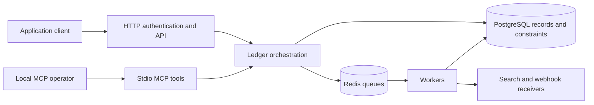

# LedgerForge architecture

LedgerForge uses a small public surface and private implementation packages to
make production integrations stable while allowing the ledger engine to evolve.

## Package layout

| Path | Responsibility |
| --- | --- |
| `/` | Stable public `ledgerforge` package. It is a compatibility facade for applications importing `github.com/devaccuracy/ledgerforge`. |
| `cmd/ledgerforge` | The LedgerForge CLI and process entry point. |
| `cmd/ledgerforge-mcp` | Local stdio MCP server for controlled agent integration. |
| `internal/core` | Ledger orchestration: transaction execution, balances, queues, lineage, and webhook workflows; composition and lifecycle of reconciliation and reindex services. |
| `api` | HTTP transport, request/response models, routing, and authentication middleware. |
| `database` | Persistence interfaces and PostgreSQL implementations. |
| `model` | Shared ledger domain types and validation. |
| `config` | Configuration loading and defaults. |
| `internal/integrity` | Read-only accounting replay over a consistent persistence snapshot. |
| `internal/policy` | Trusted principals, policy validation and spending admission contracts; PostgreSQL stores reservations and decisions. |
| `internal/reconciliation` | External uploads, reconciliation execution, matching strategies, progress, and matching rules. Consumes a narrow repository and core-injected batch and side-effect callbacks. |
| `internal/search` | Search transport and indexing, plus per-instance background reindex admission, progress, and cancellation. |
| `tests/architecture` | Parser-based import rules protecting domain services from facade, core, HTTP, and Gin dependencies. |
| `internal/*` | Private infrastructure adapters such as cache, Redis, PostgreSQL connectivity, search, locks, telemetry, and background hooks. |
| `internal/core/sql` | Embedded, ordered database migrations. |
| `tests/loadtest` | Optional load and performance tooling. |

## Dependency rules

- Consumers and entry points import the root `ledgerforge` package, never
  `internal/core`.
- HTTP handlers depend on the public ledger service; the core does not depend
  on HTTP transport packages.
- Database and infrastructure packages depend on domain models, never on API
  handlers or the CLI.
- New shared application code belongs in an existing focused package or a new
  package under `internal/`; do not add implementation files to the repository
  root.
- MCP tools depend on the public LedgerForge service surface and do not access
  persistence internals directly. Write tools are registered only when the
  operator enables them.

## Financial persistence boundary

Postings pair a source debit with an equal destination credit in integer units.
Committed balances derive from credit minus debit counters. Inflight counters
track reservations separately. A posting and its balance changes are persisted
through the database transaction path; balance versions detect stale concurrent
updates. PostgreSQL is authoritative for financial records and unique references.
Application locks and Redis coordination help manage contention but do not
replace database constraints.

Accepted transaction controls are immutable persistence evidence separate from
customer metadata. Workers and recovery restore those controls; public metadata
updates cannot change execution, lineage, policy or recovery bookkeeping.

A request may execute synchronously or persist/dispatch work for queue workers.
An accepted or queued response is distinct from a settled posting. Workers handle
scheduled execution, inflight expiry/commit and asynchronous notifications.
Recovery must preserve transaction identity and references across retries.
Operators need both persistent database storage and a queue recovery plan.

Search indexes, metrics and webhooks are downstream views of ledger activity.
They may lag or retry independently; financial decisions should read stored
transactions and balances. A dry-run projection does not lock in a future outcome.

## Trust boundaries

The HTTP master key has deployment-wide authority. Scoped keys govern API
resource access. The local MCP process opens its own configured datasource;
its write opt-in and tool confirmation are operator controls. With `--api-key`
or `LEDGERFORGE_MCP_API_KEY`, tools resolve current key validity/scopes and carry
that trusted principal into spending admission. Unbound MCP retains local
deployment-level authority. Ordinary inflight holds reserve funds; policy-held
transactions additionally require an independent persisted approval decision.
Delegation ancestry constrains effective policies and shares ancestor capacity;
approval decisions enforce the delegation-family rules in the
[agent safety guide](docs/agent-safety.md).
Keep database credentials and local MCP access within the operator's trust boundary.

Webhook receivers and outbound hook destinations are separate trust decisions.
The dedicated `notification.webhook.signing_secret` authenticates delivery;
`server.secret_key` remains a legacy fallback. Set the dedicated secret so
receivers need no API administrator credential. Public metrics use a separate
bearer token; worker monitoring and infrastructure endpoints should remain private.
See [deployment guidance](docs/deployment.md).

Reconciliation and reindex services are owned by their LedgerForge instance.
`Close` cancels/waits for their work and closes owned queue, cache, hooks and
notifier resources. Borrowed datasource lifetime remains the caller's duty.
Import-graph tests protect the extracted domain packages from HTTP, facade and
core dependencies. See [verification](docs/verification.md) and
[agent safety](docs/agent-safety.md) for the independent evidence and approval
trust boundaries.

Audit sealing uses canonical v3, introduced directly on fresh installs and
supported upgrades from main or earlier published releases. Retained v1/v2
decoders verify explicitly supplied older-format records; they do not imply
migration compatibility for unreleased development schemas. Replay
checks economic consistency separately from chain/checkpoint evidence; neither
authenticates real-world payment activity. Follow
[upgrade maintenance](docs/upgrade-notes.md) for historical evidence and migrations.

## Validation

Run `make verify` before opening a pull request. It checks module consistency,
formatting, static analysis, hermetic tests, and CLI compilation. Use
`make test-integration` for a disposable compose stack with PostgreSQL,
Redis and Typesense. Its test container shares the services' private namespace,
so fixed localhost test addresses never connect to unrelated host services.
